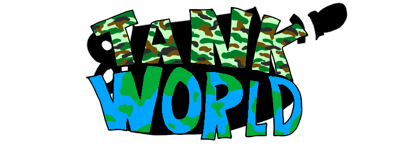
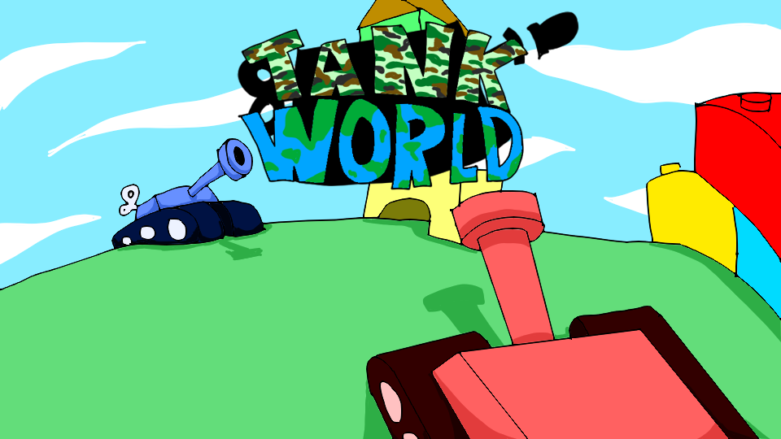
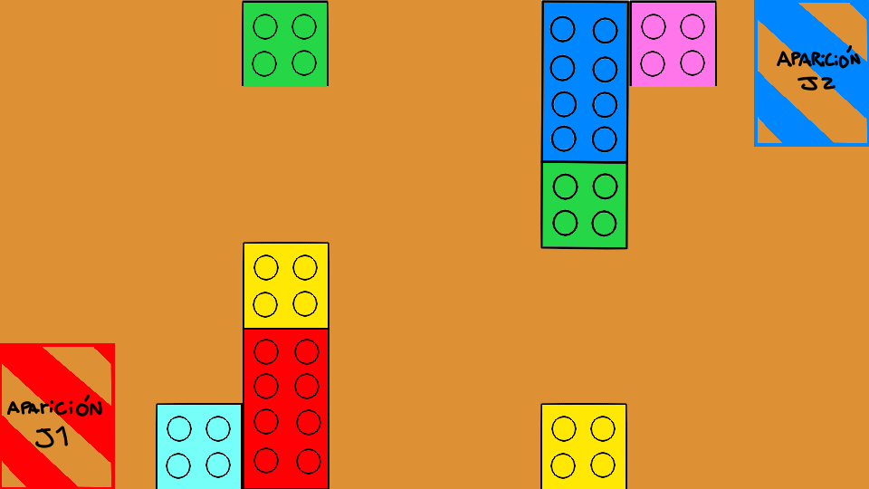
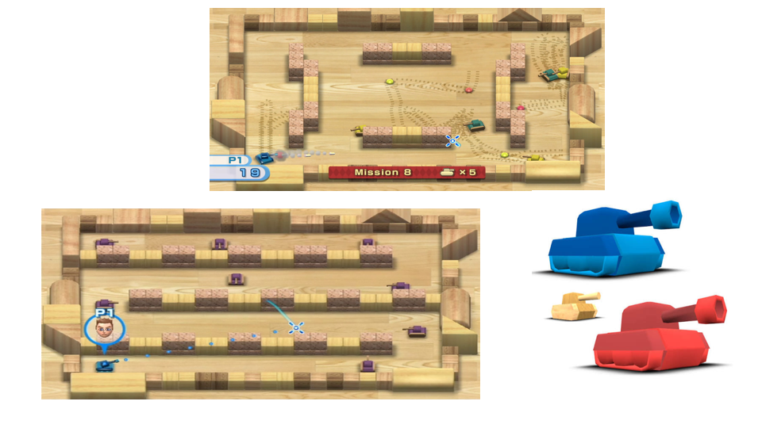
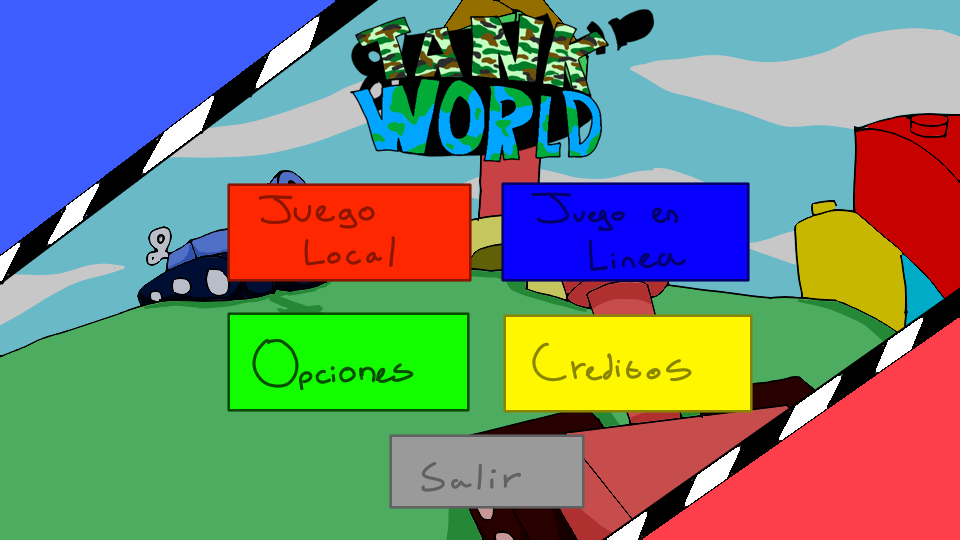
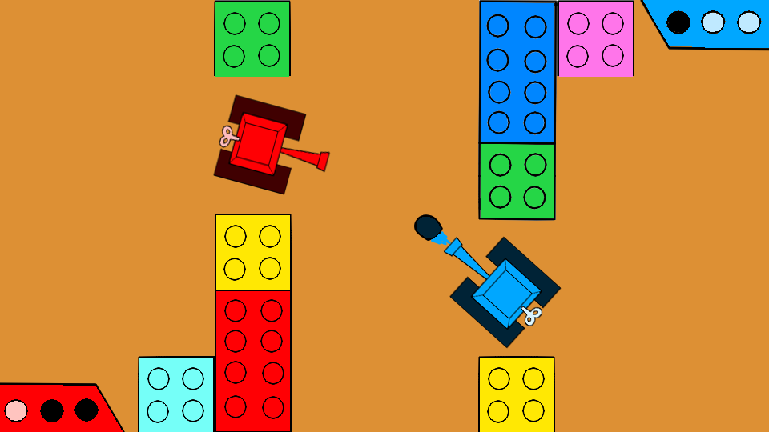
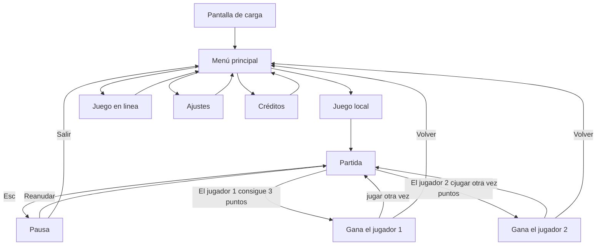

  

# Tank World

**Juegos en Red · Grado en Diseño y Desarrollo de Videojuegos · URJC · Curso 2026/27** 
**Grupo F**

## Descripción de la temática

Tank World es un juego party en 2D para dos jugadores en red en el que dos tanques de juguete tienen que enfrentarse en varios escenarios. Ambientado en una guerra de juguetes, los jugadores deben destruir los otros tanques para hacerse con la victoria.

## Equipo de desarrollo

| Nombre y apellidos | Correo URJC | GitHub |
| :--- | :--- | :--- |
| Víctor Bellón Casado | v.bellon.2024@alumnos.urjc.es | `@Victor-282006` |
| Daniel Jiménez Gómez | d.jimenezg.2024@alumnos.urjc.es | `@Dajigo333` |
| Iván Herrerín González | i.herrerin.2024@alumnos.urjc.es | `@i123van959` |

**Repositorio:** https://github.com/i123van959/Tank-World

**Licencia:** [Apache 2.0](LICENSE)

---

# Game Design Document (GDD)

## Índice

1. [Introducción](#1-introducción)
2. [Especificaciones básicas](#2-especificaciones-básicas)
3. [Jugabilidad](#3-jugabilidad)
4. [Narrativa](#4-narrativa)
5. [Imagen y diseño visual](#5-imagen-y-diseño-visual)
6. [Sonido](#6-sonido)
7. [Interfaz y diagrama de flujo](#7-interfaz-y-diagrama-de-flujo)
8. [Comunicación y marketing](#8-comunicación-y-marketing)
9. [Referencias](#9-referencias)

---

## 1. Introducción

### 1.1. Concepto del juego

Tank World es un juego party para dos jugadores en el que dos tanques se tienen que enfrentar para hacerse con la victoria. La idea principal es un enfrentamiento entre dos tanques de juguete, cada uno perteneciente a un equipo, que deben dispararse en distintos escenarios, para así acabar con el rival y conseguir la victoria.

### 1.2. Propuesta de valor

Nuestro juego destaca frente a otros debido a que vamos a incluir distintos mapas, cada uno con una ambientación única. Además vamos a incluir distintos potenciadores que harán de cada partida única. Y por último tendrá una estética atractiva que, aunque sea un juego de tanques que recuerde a la guerra, se distinguirá en todo momento que es todo un escenario montado por juguetes.

- Característica diferencial 1: Mapas variados.
- Característica diferencial 2: Potenciadores.
- Característica diferencial 3: Estética atractiva de juguetes.

*Figura 1. Imagen promocional del juego.*

---

## 2. Especificaciones básicas

| Aspecto | Descripción |
| :--- | :--- |
| **Título** | Tank World |
| **Género** | Party game |
| **Número de jugadores** | 2 (en red, tiempo real) |
| **Público objetivo** | Jugadores casuales para todas las edades |
| **Clasificación PEGI** | PEGI 3 |
| **Plataforma** | Navegador web (PC), desarrollado con Phaser 3 |
| **Duración de una partida** | 3 minutos |
| **Representación** | 2D |
| **Licencia** | Apache 2.0 |

---

## 3. Jugabilidad

### 3.1. Objetivo del juego

El objetivo de cada jugador es destruir el tanque enemigo y evitar que el rival acabe contigo. La partida termina cuando uno de los dos tanques destruye el tanque rival. Gana el jugador que consiga eliminar al contrario tres veces.

### 3.2. Controles

| Acción | Jugador 1 | Jugador 2 |
| :--- | :---: | :---: |
| Rotar a la izquierda | `A` | `←` |
| Rotar a la derecha | `D` | `→` |
| Moverse hacia delante | `W` | `↑` |
| Moverse hacia atrás | `S` | `↓` 
| Acción especial potenciador | `Espacio` | `Enter` |
| Apuntar / disparar | Ratón (clic izquierdo) | Ratón (clic izquierdo) |
| Pausa | `Esc` | `Esc` |

### 3.3. Mecánicas

#### 3.3.1. Mecánicas principales

- **Movimiento:** el tanque se puede mover hacia delante y hacia atrás dependiendo de a donde esté apuntando, para cambiar la dirección de movimiento se puede girar el tanque hacia la izquierda o hacia la derecha.
- **Disparo:** el tanque podrá disparar cada medio segundo en la dirección en la que este apuntando.
- **Potenciadores:** se podrán recoger potenciadores que aparecerán en el mapa, de los cuales, cada uno, tendrá una función distinta.

#### 3.3.2. Objetos y power-ups

| Objeto | Efecto | Duración | Aparición |
| :--- | :--- | :---: | :--- |
| Disparo explosivo | Disminuye el alcance del disparo, pero inflige daño en una pequeña área | 15 s | Aleatoria con tiempo indeterminado |
| Barrera | Mientras este activa el tanque no puede recibir daño | 10 s | Aleatoria con tiempo indeterminado |
| Disparo triple | Dispara tres balas, una hacia delante y dos ligeramente giradas hacia cada lado | 15 s | Aleatoria con tiempo indeterminado |
| Rebote | Las balas disparadas tienen la capacidad de rebotar una vez en las paredes | 15 s | Aleatoria con tiempo indeterminado |
| Más cadencia | Aumenta la cadencia de disparo pero disminuye el daño | 15 s | Aleatoria con tiempo indeterminado |

#### 3.3.3. Sistema de puntuación

Al acabar con el jugador contrario se conseguirá un punto. Gana el jugador que consiga tres puntos.

### 3.4. Físicas y dificultad

- **Colisiones:** entre proyectiles, obstáculos y jugadores.
- **Rebotes:** con el potenciador de rebote las balas rebotaran con los obstáculos.
- **Plataformas móviles o superficies especiales:** obstáculos con desplazamiento, obstáculos destructibles y obstáculos que impiden el paso pero no el disparo.
- **Progresión de la dificultad:** a medida que avanza la partida aparecen más potenciadores que dificultaran esquivar los disparos del rival.

### 3.5. Escenario

El escenario representa una habitación de un niño. Se compone de 3 zonas que se diferencian por los bloques que hacen de muro:

1. **Zona 1: la parte de la izquierda donde aparece el jugador 1.
2. **zona 2: el centro del escenario donde se cruzan ambos jugadores .
3. **Zona 3: la parte de la derecha donde aparece el jugador 2.

*Figura 2. Mapa del escenario con zonas de aparición, plataformas y obstáculos.*

---

## 4. Narrativa

### 4.1. Historia
Dos hermanos que estaban visitando la casa de sus abuelos deciden buscar algo para entretenerse entre los juguetes antiguos del desván y encuentran una caja con dos tanques en la tapa. Al abrirla encuentran dos tanques con balas de plastico para cargarlos y deciden crear su propio escenario para jugar.

### 4.2. Personajes

#### Tanque rojo (Jugador 1)

- **Edad / origen:** 8 años.
- **Personalidad:** Competitivo.
- **Motivación:** Ganar a su hermano en el juego.
- **Trasfondo:** Es el hermano pequeño. Quiere ganar a su hermano siempre para intentar ser mejor que él. 

#### Tanque azul (Jugador 2)

- **Edad / origen:** 10 años.
- **Personalidad:** Empático.
- **Motivación:** Que su hermano se divierta.
- **Trasfondo:** Es el hermano mayor. Intenta jugar con su hermano siempre que pueda para que no se aburra. Le gusta jugar con su hermano por mero entretenimiento, pero no se deja ganar por él.
---

## 5. Imagen y diseño visual

### 5.1. Logotipo

*Figura 3. Logotipo del juego.*

### 5.2. Estilo visual

El juego utiliza un estilo **cartoon** porque da mayor sensación de que sea un juego de dos niños, en vez de una guerra real.

### 5.3. Uso de colores
- El juego usara principalmente colores llamativos para los escenarios y objetos similar a los usados en juguetes.
- El jugador 1 se vera representado por una paleta de colores rojos y el jugador 2 se vera representados por una paleta de colores azules.

*Figura 4 y 5. Paletas de colores del jugador 1 y 2 respectivamente.*

### 5.4. Aspectos técnicos: cámara y representación

- **Representación:** 2D, vista cenital.
- **Cámara:** fija mostrando el escenario.
- **Resolución base:** 1920 x 1080 pixeles.

### 5.5. Inspiración artística y cultural

*Figura 6. Moodboard con las referencias visuales.*

- **Wii play (2006)**

### 5.6. Bocetos de personajes y pantallas

Los bocetos de los personajes se encuentran en el apartado [4.2](#42-personajes) y los de las pantallas en el apartado [7.1](#71-pantallas).

---

## 6. Sonido

### 6.1. Banda sonora

| Pista | Escena | Estilo / ambiente | Fuente / licencia |
| :--- | :--- | :--- | :--- |
| AAA | Menú principal | AAA (p. ej. *chiptune* relajado) | AAA (propia / CC-BY...) |
| BBB | Partida | BBB (p. ej. ritmo rápido, 140 BPM) | BBB |
| CCC | Victoria / derrota | CCC | CCC |

### 6.2. Efectos de sonido

| Efecto | Momento en que se reproduce |
| :--- | :--- |
| Disapro | Al pulsar la tecla de disparo |
| Golpe / impacto | Al acertar un disparo o recibir daño |
| Activar potenciador | Al activar un potenciador |
| Botones de la interfaz | Al pasar el ratón y al hacer clic |
| Aparición de potenciador | Al aparecer un potenciador en el mapa |

---

## 7. Interfaz y diagrama de flujo

### 7.1. Pantallas

**Menú principal**

*Figura 7. Menú principal.*

**Pantalla de juego (HUD)**

*Figura 8. Pantalla de juego.*

### 7.2. Diagrama de flujo

## 8. Comunicación y marketing

- **Público y mensaje clave:** Jugadores casuales de todas las edades. Partidas cortas y frénitcas.
- **Canales:** redes sociales (instagram, you-tube,tik tok), itch.io, Newgrounds.
- **Eslogan:** «Partidas cortas, diversión en cualquier momento».

---

## 9. Referencias

[1] WII play (2006). Nintendo

